# CAPSTONE PROJECT REPORT
## Milestone–1: Project Proposal, Requirements and Feasibility

---

# CodeAI: AI-Powered Coding Interview Platform

**Session:** 2026–27  
**Academic Program:** B.Tech. — Computer Science Engineering  
**Institution:** School of Computer Science Engineering and Technology, Bennett University  

**Submitted by:**  
* **Shobhit Tiwari** (Student ID: `E23CSEU0891`)  
* **Tanmay Sony** (Student ID: `E23CSEU0893`)  

**Faculty Mentor:** Dr. Jagender Singh  
**Project Repository:** [github.com/Shobhit2636/CodingInterview](https://github.com/Shobhit2636/CodingInterview)  
**Live Production Deployment:** [coding-interview-78ad.vercel.app](https://coding-interview-78ad.vercel.app)  

---

## CERTIFICATE

This is to certify that the report titled **“CodeAI: AI-Powered Coding Interview Platform”** has been prepared by **Shobhit Tiwari** (Student ID: `E23CSEU0891`) and **Tanmay Sony** (Student ID: `E23CSEU0893`) as the Milestone–1 submission of the Capstone Project. The report describes the problem being addressed, the proposed system, its relationship to relevant Sustainable Development Goals, a review of related tools and approaches, requirements, feasibility, risks, methodology, system implementation architecture, and expected outcomes.

 

**Date:** `26-11-2026`  
**Internal Guide / Faculty Mentor:** Dr. Jagender Singh  
**Signature:** ___________________________  

---

## ACKNOWLEDGEMENT

We would like to express our deepest gratitude to our faculty mentor, **Dr. Jagender Singh**, and the School of Computer Science Engineering and Technology at Bennett University for providing the academic guidance, computational facilities, and encouraging environment needed to develop this capstone project proposal. We also acknowledge the open-source developer community and the comprehensive documentation maintained by the libraries and platforms utilized in this project.

The CodeAI repository and its engineering implementation provided the primary empirical basis for this report. The repository presents an end-to-end coding interview preparation platform combining an interactive coding workspace, AI-assisted spoken/text mock interviews, sandboxed code execution, peer collaboration, and learning analytics across web and native mobile environments.

---

## ABSTRACT

Preparing for software engineering technical interviews requires repeated practice across data structures and algorithms, the ability to write clean, syntactically correct code under time constraints, and the competence to verbally articulate thought processes to interviewers. Learners conventionally switch between fragmented tools: competitive programming sites for algorithms, communication apps for peer mock rounds, external chatbots for explanations, and personal notes for tracking progress. This context switching impairs preparation consistency and obscures qualitative diagnostic feedback.

This project presents **CodeAI**, an integrated AI-powered coding interview and preparation platform designed as a unified full-stack web and native mobile application. CodeAI combines:
1. A Monaco-based coding workspace with multi-language execution support (C++, Python, JavaScript, Java);
2. A categorized Question Bank with difficulty, topic, and FAANG company metadata;
3. Real-time spoken/text AI mock interviews leveraging Google Gemini and Web Speech APIs;
4. Low-latency collaborative peer coding rooms powered by Socket.IO;
5. Dedicated architectural and behavioral modules (System Design canvas and STAR method manager rounds);
6. Visual performance analytics (skill strength radar charts and submission distribution donuts);
7. A cross-platform React Native (Expo) mobile application offering synchronized access on Android and iOS devices.

This Milestone–1 report specifies the problem definition, objectives, SDG alignments, literature review, functional and non-functional requirements, technical feasibility, risk mitigation strategies, system architecture, and visual evidence from the working prototype.

---

## TABLE OF CONTENTS

| Section | Title |
|:---|:---|
| **1** | Problem Statement and Motivation |
| **2** | SDG Mapping and Rationale |
| **3** | Background and Context |
| **4** | Literature and Existing Solution Review |
| **5** | Gap Analysis |
| **6** | Stakeholder and Requirements Analysis |
| **7** | Technology and Tool Selection |
| **8** | Feasibility Study |
| **9** | Scope and Limitations |
| **10** | Risk Analysis and Mitigation Strategy |
| **11** | Proposed Solution, Architecture and Implementation Screenshots |
| **12** | Expected Outcomes |
| **13** | Conclusion |
| **14** | References |

---

## 1. PROBLEM STATEMENT AND MOTIVATION

### 1.1 Motivation
Software engineering interview preparation extends beyond memorizing code solutions. Candidates must choose appropriate data structures, reason about asymptotic time and space complexities, address edge cases, and articulate decisions under scrutiny. Traditional problem archives offer extensive algorithmic question catalogs but lack conversational interview simulations, collaborative whiteboards, or integrated diagnostics.

A unified platform bridges this gap by bringing algorithm problem-solving, real-time code execution, AI mock interviewers, peer collaboration, and progress analytics into a cohesive interface. Conversational AI acts as an autonomous technical interviewer, probing candidates on trade-offs and edge cases, while deterministic execution engines validate algorithmic correctness.

### 1.2 Problem Statement
Learners preparing for technical software engineering interviews require an integrated, accessible environment to solve algorithmic problems, compile code, rehearse spoken technical explanations, collaborate on shared boards, and track preparation milestones. The project aims to develop **CodeAI** as a multi-platform environment (Web & Mobile) and evaluate whether an integrated workflow enhances learning consistency, practice convenience, and diagnostic clarity.

### 1.3 Objectives
| ID | Objective | Proposed Acceptance Target |
|:---|:---|:---|
| **O1** | Provide a browser & mobile coding workspace with structured question discovery. | Question-to-editor workflow operates seamlessly with multi-language selection. |
| **O2** | Support code execution and runtime test validation. | Known test cases pass for supported languages (Python, JS, C++, Java); runtime errors reported. |
| **O3** | Enable autonomous AI-assisted spoken/text mock interviews. | Real-time speech recognition, synthesis, and Gemini-powered critique operate without failure. |
| **O4** | Support real-time peer collaborative coding. | Two connected clients exchange editor events, code synchronization, and room chat via Socket.IO. |
| **O5** | Provide performance tracking and skill visualization. | Dashboard displays skill radar charts, submission outcomes, rating benchmarks, and streaks. |
| **O6** | Deliver native mobile accessibility and session security. | React Native application supports persistent authentication, account management, and one-tap logout. |

---

## 2. SDG MAPPING AND RATIONALE

| SDG / Target | Potential Contribution | Possible Indicator |
|:---|:---|:---|
| **SDG 4 — Quality Education (Target 4.4)** | Provides free, equitable access to technical interview training tools regardless of geographical or financial constraints. | Completion of problem sets; self-paced interview practice sessions; topic mastery. |
| **SDG 8 — Decent Work & Economic Growth (Target 8.5)** | Enhances employability and technical interview readiness for students and junior software engineers entering the global workforce. | Practice consistency; candidate confidence metrics; problem solving streaks. |
| **SDG 9 — Industry, Innovation & Infrastructure (Target 9.5)** | Integrates cloud architectures, generative AI, and real-time WebSockets into an educational software ecosystem. | Prototype stability; low-latency event exchange; cross-platform uptime. |

---

## 3. BACKGROUND AND CONTEXT

Technical interviews evaluate three core competencies:
1. **Algorithmic Proficiency:** Selecting appropriate algorithmic paradigms (Dynamic Programming, Graph traversals, Sliding Window, Greedy approaches).
2. **Implementation Quality:** Writing syntactically sound, boundary-tested code in production languages.
3. **Communication & Architectural Thinking:** Explaining complexity trade-offs, handling follow-up constraints, and scaling distributed architectures.

CodeAI addresses these dimensions through an orchestrated tech stack: a React/Vite/TypeScript client, an Express.js API, SQLite local persistence, Google Gemini Generative AI, Socket.IO WebSockets, and a companion React Native (Expo) mobile app.

---

## 4. LITERATURE AND EXISTING SOLUTION REVIEW

| Tool / Category | Typical Strengths | Identified Gap Addressed by CodeAI |
|:---|:---|:---|
| **Competitive Programming Sites** (LeetCode, HackerRank) | Extensive problem archives, verified test suites, global ranking leaderboards. | Lack autonomous spoken interview simulations; peer collaboration is absent or locked behind paywalls. |
| **General AI Assistants** (ChatGPT, Claude) | Conversational explanations, syntax hints, conceptual walk-throughs. | Disconnected from runtime compilers; candidates must manually copy-paste code; lack structured curricula. |
| **Human Mock Services** (Pramp, Interviewing.io) | Authentic peer/engineer dialogue, genuine behavioral assessment. | High monetary cost or scheduling overhead; impractical for daily, spontaneous revision. |
| **Collaborative Cloud Editors** (Replit, CodeSandbox) | Multi-cursor live editing, cloud container compilation. | Generic developer tooling without interview-specific rubrics, question banks, or AI interviewers. |
| **CodeAI (Proposed System)** | **Integrated Ecosystem:** Question bank, code sandbox, AI speech interviews, collaboration, system design canvas, and mobile app. | Unifies preparation workflows into a single authenticated experience. |

---

## 5. GAP ANALYSIS

| Capability | Coding Platforms | AI Chatbots | Peer Mock Sites | CodeAI Unified Platform |
|:---|:---:|:---:|:---:|:---:|
| **Structured Question Bank** | High | Low | Low | **High (Curated FAANG Catalog)** |
| **Sandboxed Code Execution** | High | None | Low | **High (Multi-language sandbox)** |
| **Spoken Voice AI Interview** | None | Limited text | Human-only | **High (Real-time Speech Synthesis/Recognition)** |
| **Real-Time Collaboration** | None | None | High | **High (Socket.IO Virtual Rooms)** |
| **System Design Canvas** | None | Text only | Whiteboard | **High (Dedicated Architectural Intake)** |
| **Behavioral Mock (STAR)** | None | Unstructured | Human-only | **High (Structured Rubric Assessment)** |
| **Cross-Platform Mobile App** | Basic reader | Chat app | None | **High (Dedicated React Native Native App)** |

---

## 6. STAKEHOLDER AND REQUIREMENTS ANALYSIS

### 6.1 Functional Requirements (FR)
* **FR-01:** The system shall display categorized algorithm problems with tags, constraints, and initial code stubs.
* **FR-02:** The system shall execute user code (Python, JavaScript, C++, Java) in a secured environment and return stdout, runtime, and memory metrics.
* **FR-03:** The system shall simulate a technical interviewer using Google Gemini, listening via Web Speech API and synthesizing spoken feedback.
* **FR-04:** The system shall enable two users to join a shared room via unique session IDs with synchronized editor changes and real-time chat.
* **FR-05:** The system shall provide an architectural workspace for System Design prompts with scalability evaluations.
* **FR-06:** The system shall evaluate behavioral responses based on the STAR methodology (Situation, Task, Action, Result).
* **FR-07:** The system shall provide a visual Dashboard tracking problem rating, points, streak, accuracy, and skill strengths.
* **FR-08:** The system shall support secure User Authentication (Sign In, Sign Up, and prominent Log Out) across web and mobile.

### 6.2 Non-Functional Requirements (NFR)
* **NFR-01 (Performance):** Code execution and compiler responses shall complete within acceptable execution bounds (< 5 seconds for normal test cases).
* **NFR-02 (Reliability):** AI API failure or network degradation shall gracefully fall back without application crashes.
* **NFR-03 (Responsiveness):** UI elements must adapt seamlessly across desktop browsers, tablet screens, and mobile form factors.
* **NFR-04 (Security):** Code execution must be isolated; API keys and secrets must remain protected on the backend.

---

## 7. TECHNOLOGY AND TOOL SELECTION

| Layer | Technology | Version | Purpose in CodeAI |
|:---|:---|:---|:---|
| **Frontend Web** | React, TypeScript, Vite | React 18, Vite 5 | Reactive client UI, type safety, fast bundling |
| **Styling** | Tailwind CSS, Lucide React | v3.4 | Dark FAANG aesthetic, responsive layout, iconography |
| **Code Editor** | Monaco Editor | `@monaco-editor/react` | Industrial code editor with syntax highlighting and auto-complete |
| **Data Visualization**| Recharts | v2.12 | Radar charts, Donut charts, and performance heatmaps |
| **Mobile Application**| React Native, Expo | Expo SDK 58, RN 0.88 | Cross-platform native mobile app for Android and iOS |
| **Backend API** | Node.js, Express.js | Express 4, TS Node | REST endpoints, compilation routing, auth logic |
| **Real-time Comms** | Socket.IO | v4.7 | WebSocket server and client for collaborative rooms |
| **AI Engine** | Google Gemini API | `@google/generative-ai` | Conversational interview reasoning and code assessment |
| **Data Storage** | SQLite & AsyncStorage | `better-sqlite3`, AsyncStorage | Relational data persistence on backend; offline storage on mobile |
| **Hosting & Cloud** | Vercel & Cloudflare | Production CDN | Global low-latency static hosting with HTTPS |

---

## 8. FEASIBILITY STUDY

* **Technical Feasibility:** The architecture utilizes mature, well-documented frameworks. Prototyping confirmed that Monaco Editor, Web Speech APIs, Gemini API, and React Native Expo integrate reliably.
* **Economic Feasibility:** The prototype leverages open-source libraries and generous free-tier cloud allocations (Vercel, GitHub, Google Gemini Free Tier), requiring minimal capital expenditure during academic development.
* **Operational Feasibility:** The platform requires no client-side setup for web users (browser-accessible) and provides 1-tap installation via Progressive Web App (PWA) and Expo Go for mobile users.

---

## 9. SCOPE AND LIMITATIONS

### In-Scope
* Web-based coding platform with integrated editor, compiler runner, and question catalog.
* Spoken AI Voice Interviewer with audio pulse animations and live rubric critiques.
* Real-time multi-user collaborative room with synchronized code and chat.
* Specialized System Design and Behavioral Mock modules.
* Native React Native mobile app with full authentication and question bank access.

### Limitations
* Speech recognition quality depends on client microphone hardware and browser Web Speech support.
* Code execution security in production requires sandboxed virtualization (e.g., Docker/gVisor containers) to prevent unauthorized host calls.
* AI feedback latency depends on third-party Gemini API availability and rate quotas.

---

## 10. RISK ANALYSIS AND MITIGATION STRATEGY

| Risk ID | Identified Risk | Impact | Likelihood | Mitigation Strategy |
|:---|:---|:---:|:---:|:---|
| **R1** | Unsafe execution of user submitted code | High | Medium | Execute code in isolated subprocesses with strict memory/time bounds; prepare Docker runner. |
| **R2** | Third-party AI API rate limiting or outage | Medium | Medium | Implement structured error fallbacks and resilient offline mock prompts. |
| **R3** | Real-time WebSocket disconnections | Medium | Low | Implement auto-reconnect listeners in Socket.IO and state caching. |
| **R4** | Mobile authentication desynchronization | Medium | Low | Deploy dual persistence using `AsyncStorage` and cloud sync with input validation. |

---

## 11. PROPOSED SOLUTION, ARCHITECTURE AND IMPLEMENTATION SCREENSHOTS

The proposed CodeAI platform has been engineered into functional web and mobile prototypes. Below are the verified screenshots representing the modules and user workflows.

### 11.1 Web Application Platform

#### A. Central Analytics Dashboard
The central dashboard provides candidates with quantitative tracking of their interview readiness. It features platform ratings, points earned, problem counts, submission accuracy, a 5-axis Skill Strengths Analysis radar chart (Dynamic Programming, Graphs, Arrays, Strings, Sliding Window), and a Submission Outcomes distribution chart. The header and sidebar include prominent **Log Out** controls.

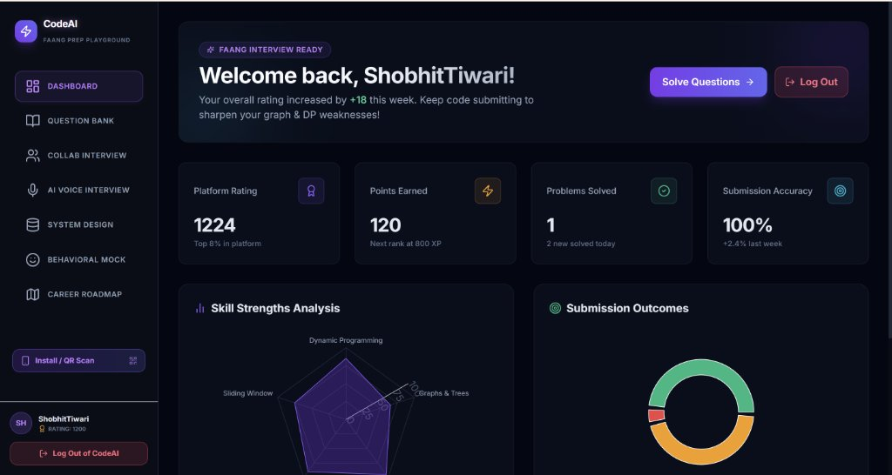
*Figure 1: CodeAI Production Web Dashboard — Displaying user rating (1224), points, skill radar chart, and prominent Log Out controls.*

---

#### B. Curated Coding Question Bank
The Question Bank categorizes algorithmic problems by difficulty (Easy, Medium, Hard), topic tags (Array, Hash Table, Dynamic Programming, Graph), and hiring companies (Google, Amazon, Microsoft). Each card provides one-click options to either launch the **Coding Sandbox** or start an **AI Voice Interview** directly on that problem.

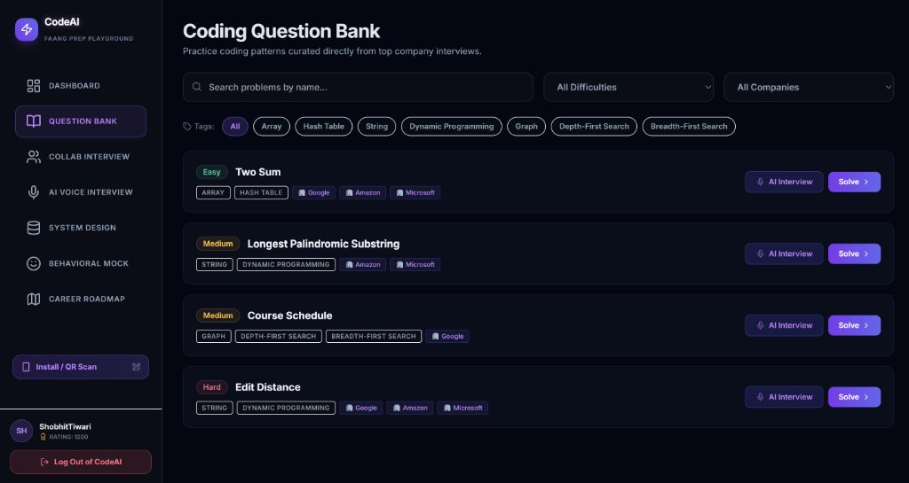
*Figure 2: Coding Question Bank — Filterable list of curated FAANG interview challenges with company tags.*

---

#### C. Real-Time Collaborative Interview Room
Powered by Socket.IO, this module allows peer candidates to enter shared virtual rooms using unique Session IDs. It provides dual-cursor live code synchronization, real-time audio chat capabilities, and shared problem discussion.

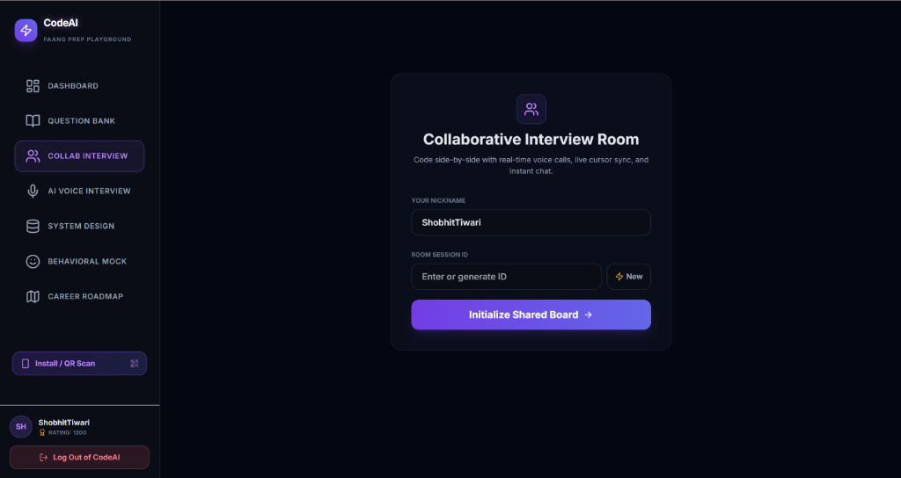
*Figure 3: Collaborative Interview Room — Interface for initializing shared boards and live multi-cursor peer coding.*

---

#### D. AI Spoken Voice Interviewer
The voice interview module replicates a high-pressure FAANG technical interview. Candidates select target problems, choose interviewer voice accents (e.g., English India / US), and interact orally. The AI interviewer synthesizes speech, listens via speech recognition, and generates evaluation reports on candidate communication and code logic.

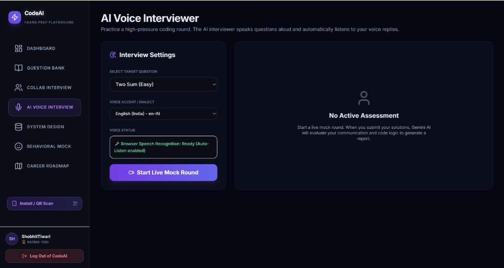
*Figure 4: AI Voice Interviewer — Voice intake, dialect selection, and real-time speech assessment interface.*

---

#### E. AI System Design Round
System design interviews assess distributed systems architecture. CodeAI provides an architectural prompt intake (e.g., Design TinyURL, Scalable Notification Service) with explicit traffic, sharding, and consistency constraints evaluated by AI models.

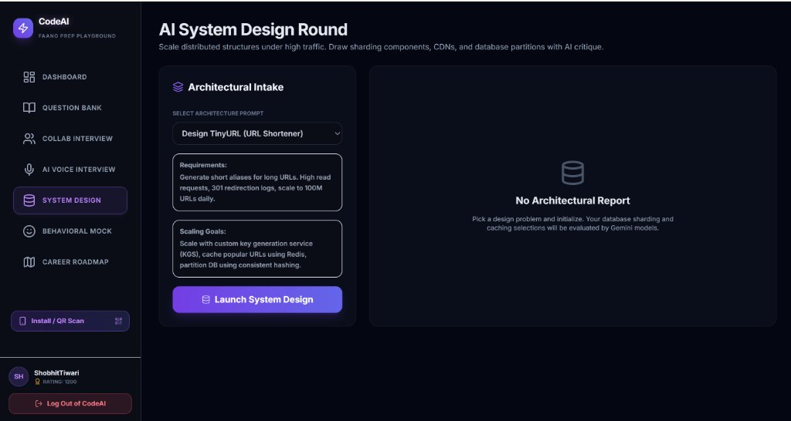
*Figure 5: AI System Design Studio — Formulating high-level system requirements, scaling goals, and distributed critiques.*

---

#### F. AI Behavioral Mock Round (STAR Method)
Evaluates leadership, teamwork, and cultural alignment using the structured **STAR methodology** (Situation, Task, Action, Result). The AI interviewer prompts candidates on conflict resolution and project deadlines, generating rubric-based feedback.

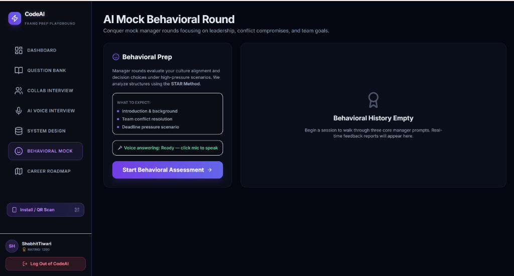
*Figure 6: AI Mock Behavioral Round — Candidate evaluation using structured managerial interview scenarios.*

---

#### G. AI Career Roadmap Generator
Generates personalized, day-by-day technical preparation roadmaps. Candidates input their target company (e.g., Google) and weak subjects (e.g., Dynamic Programming, Graphs) along with resume highlights to receive an adaptive learning schedule.

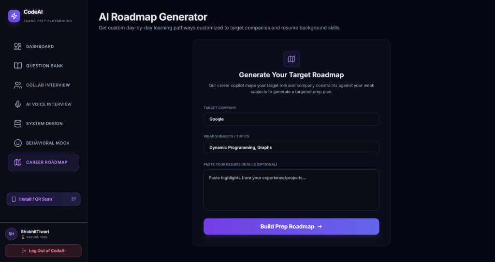
*Figure 7: AI Career Roadmap Generator — Custom pathway synthesizer based on target employer and candidate weaknesses.*

---

### 11.2 React Native Native Mobile Application

To ensure practice mobility, CodeAI was built as a dedicated cross-platform mobile application using **React Native and Expo SDK 58**.

#### A. Mobile Dashboard & Header Logout
The mobile dashboard features touch-optimized stat cards, rating badges, active streak counters, and a bottom navigation bar. An explicit **Logout button** with a confirmation dialog is positioned at the top header for instant session control.

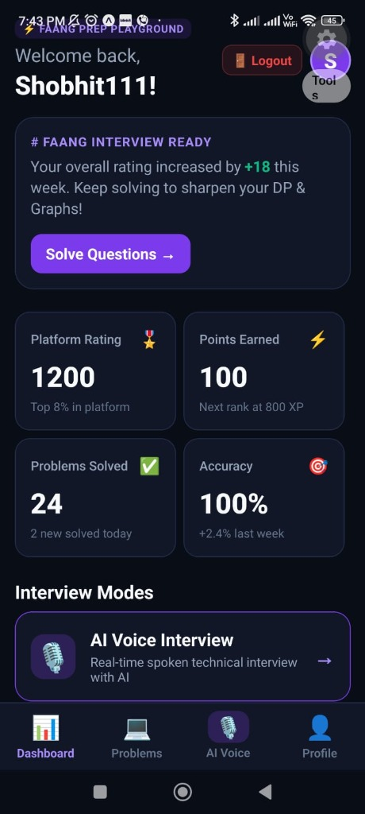
*Figure 8: React Native Mobile App — Mobile Dashboard with touch stats cards, bottom tabs, and top header Logout.*

---

#### B. Mobile Coding Questions Catalog
The mobile Question Bank features difficulty filter chips (All, Easy, Medium, Hard), search bars, acceptance rate indicators, and solved status badges.

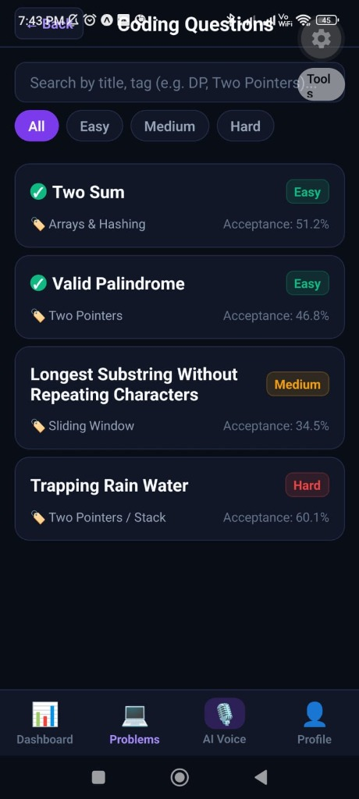
*Figure 9: Mobile Question Bank — Algorithmic problem list with responsive filter chips and status indicators.*

---

#### C. Mobile User Profile & Session Security
The Profile screen displays candidate identity, email, active streaks, account performance statistics, and cloud synchronization status. A prominent **Log Out of CodeAI** button allows users to end sessions securely.

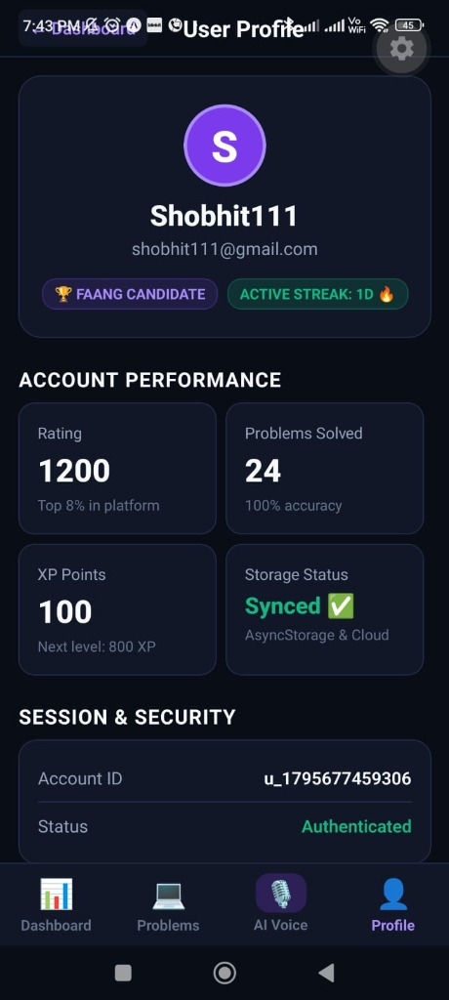
*Figure 10: Mobile Profile Screen — Detailed performance metrics, cloud sync confirmation, and session security.*

---

#### D. Mobile Spoken AI Voice Interviewer
The mobile AI Voice Interviewer provides an on-the-go conversational practice experience. It includes an animated sound pulse visualizer, push-to-talk microphone toggling, and live dialogue transcription.

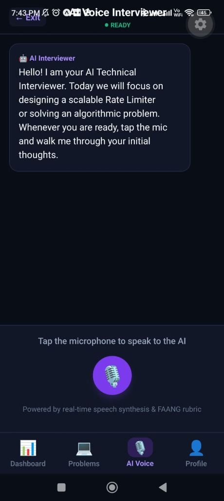
*Figure 11: Mobile AI Voice Mock — Real-time conversational interview dialogue with animated audio pulse feedback.*

---

## 12. EXPECTED OUTCOMES

The final deliverable of this Capstone Project is a fully tested, dual-platform software ecosystem:
1. **Production Web Application:** Deployed on cloud CDN with global low-latency access;
2. **Native Mobile App:** Packaged for Android and iOS devices using Expo EAS;
3. **Verified Code Execution Engine:** Sandboxed compiler runners supporting C++, Python, JavaScript, and Java;
4. **Autonomous AI Evaluators:** Gemini-integrated models for algorithmic complexity, behavioral responses, and system design critiques;
5. **Collaborative Virtual Rooms:** Low-latency multi-client WebSocket synchronization for peer interviews.

---

## 13. CONCLUSION

CodeAI addresses the fragmentation of modern technical interview preparation by unifying problem solving, sandboxed execution, real-time collaboration, autonomous AI speech interviews, and performance tracking into one cohesive platform.

This Milestone–1 proposal has established the technical feasibility, functional architecture, and risk mitigation strategies for the platform. Working implementations of both the full-stack web platform and the native React Native mobile application confirm that the proposed integrations operate harmoniously. Subsequent project milestones will focus on rigorous automated testing, containerized sandbox hardening, and empirical user study evaluations.

---

## 14. REFERENCES

1. Shobhit2636, *“CodingInterview: CodeAI — AI-Powered Coding Interview Platform,”* GitHub Repository, 2026. Available: `https://github.com/Shobhit2636/CodingInterview`
2. React Documentation, *“React — A JavaScript library for building user interfaces,”* Meta Open Source, 2026. Available: `https://react.dev/`
3. React Native Documentation, *“React Native — Learn once, write anywhere,”* Meta Open Source, 2026. Available: `https://reactnative.dev/`
4. Expo Documentation, *“Expo SDK 58 Reference and Tooling,”* Expo, 2026. Available: `https://docs.expo.dev/`
5. Vite Documentation, *“Next Generation Frontend Tooling,”* 2026. Available: `https://vite.dev/`
6. Express.js, *“Fast, unopinionated, minimalist web framework for Node.js,”* 2026. Available: `https://expressjs.com/`
7. Socket.IO Documentation, *“Bidirectional and low-latency communication for every platform,”* 2026. Available: `https://socket.io/`
8. Microsoft, *“Monaco Editor — The code editor that powers VS Code,”* 2026. Available: `https://microsoft.github.io/monaco-editor/`
9. Google AI for Developers, *“Gemini API Documentation and Generative AI SDK,”* Google, 2026. Available: `https://ai.google.dev/`
10. SQLite, *“Small. Fast. Reliable. Choose any three.”* 2026. Available: `https://www.sqlite.org/`
11. United Nations, *“Transforming our world: The 2030 Agenda for Sustainable Development (SDGs),”* UN A/RES/70/1, 2015.
12. OWASP Foundation, *“OWASP Top 10 Application Security Risks,”* 2025–26.
