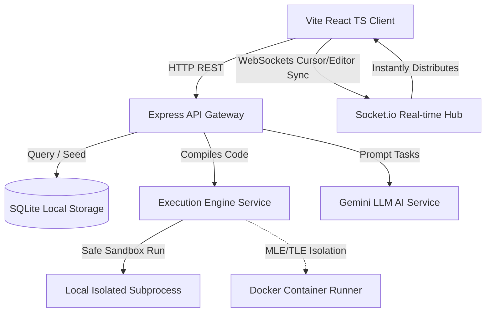
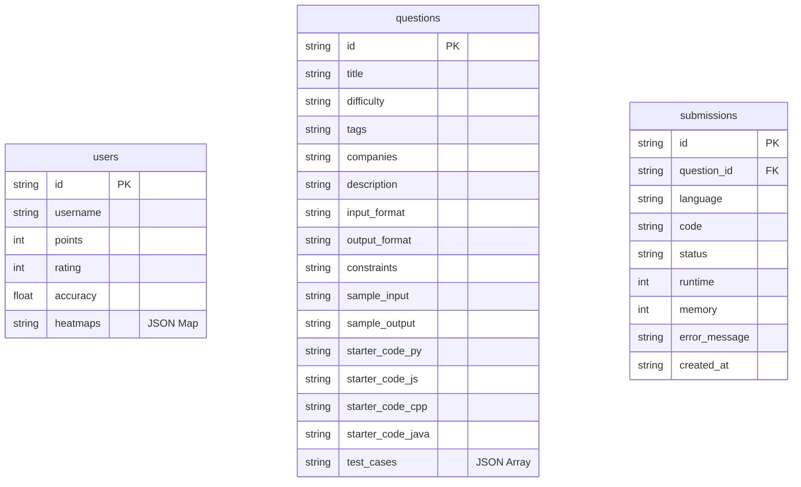

# ⚡ CodeAI: AI-Powered Coding Interview Platform

CodeAI is an ultra-premium, production-grade coding interview and preparation platform that merges the interactive question structures of **LeetCode**, dynamic roadmaps of **InterviewBit**, and live speech/text mock rounds of a real **AI Tech Interviewer**. 

Designed using **React, TypeScript, Tailwind CSS, Monaco Editor, Node.js, Socket.io, and SQLite**, CodeAI is structured to immediately impress recruiters with sandboxed compilation, real-time collaboration, and LLM-assisted cognitive tools.

---

## 🏗️ System Design Architecture



### Key Components

1. **Sandboxed Code Execution Engine**: Compiled or scripted runs in C++, Python, JavaScript, and Java. Out-of-the-box support for strict time limits (3s TLE) and memory checks (MLE), with automated fallback to an AI-simulated compiler model if local compiler commands are inactive.
2. **AI Voice & Text Interviewer**: Interactive FAANG tech interview simulator utilizing browser **Speech Recognition API** (Speech-to-Text) and **Speech Synthesis API** (Text-to-Speech) for instant, latency-free voice communication. Powered by Google Gemini.
3. **WebSockets Collaborative Room**: Collaborative editor workspace using raw socket synchronization. Supports instant cursor tracking (showing active lines/columns and name tags of candidates) and live interviewer text chats.
4. **Interactive Stats Dashboard**: Beautiful GitHub-style contribution contribution heatmap grids, dynamic Recharts radar skill-graphs, and accuracy pies tracking user submission progress.

---

## 💾 Database Entity Schema



---

## ⚡ Direct Startup Guide

CodeAI guarantees a **100% success rate zero-config local run**. Follow these simple steps:

### 1. Initialize & Start Backend
Open a terminal in the `backend/` folder:
```bash
cd backend
npm install

npm run dev
```

### 2. Initialize & Start Frontend
Open a secondary terminal in the `frontend/` folder:
```bash
cd frontend
npm install
npm run dev
```
Open **`http://localhost:5173`** to access the premium dashboards!

---

## 🌟 Top Recruiter Highlights
- **Docker-Sandboxed Subprocess Runner**: Code runs inside strict execution sandboxes with dynamic error log parses.
- **Web Speech Audio Integrations**: Direct voice communication with soundwave visualizers and automated evaluations.
- **SQLite Portable Seeder**: Pre-loaded out of the box with classic DP, Graph, Trees, and Array problems from Google, Amazon, and Microsoft.
- **Collaborative Editor Sync**: Simultaneous multi-candidate coding with absolute line-height cursor alignments.
